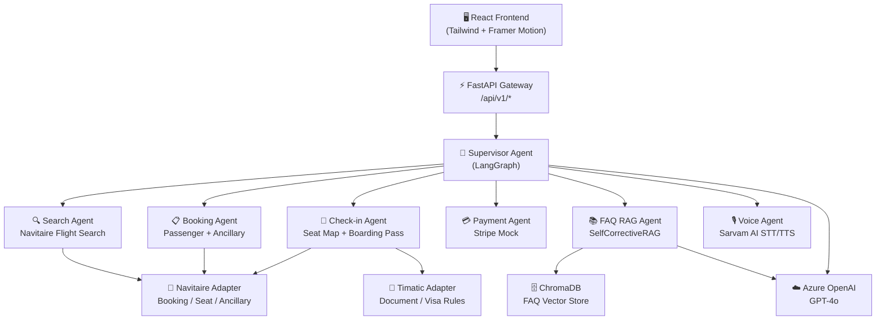
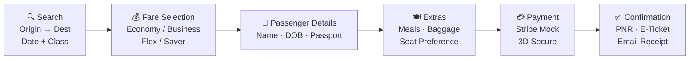
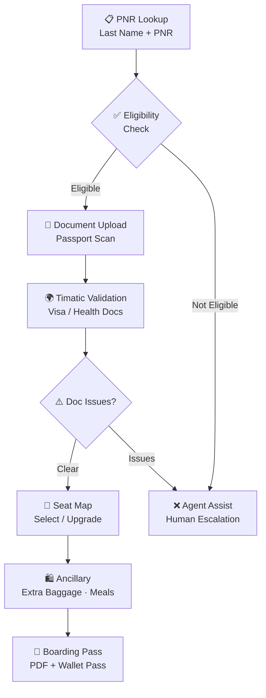
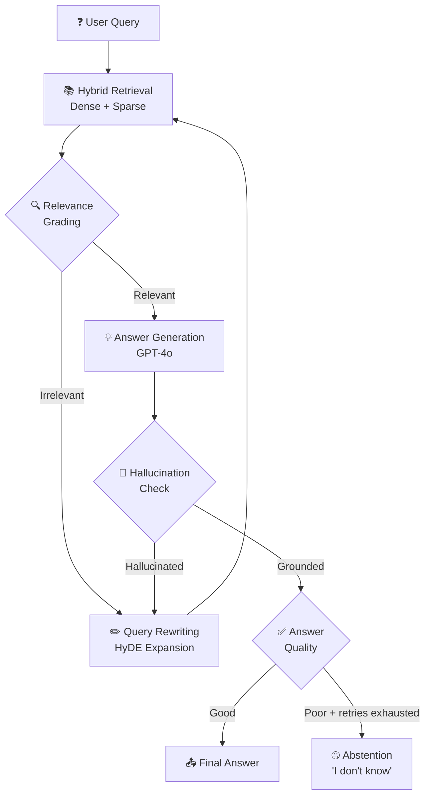

# ✈️ Emirates Flight Booking + Web Check-in POC

      

**A full-stack, multi-agent proof-of-concept for Emirates-style flight booking and web check-in — powered by LangGraph, Azure OpenAI GPT-4o, Sarvam AI voice, and a self-corrective RAG FAQ engine.**

> ⚠️ **Disclaimer:** This is an unofficial proof-of-concept. It is **not** affiliated with, endorsed by, or a product of Emirates Group or any of its subsidiaries. All flight data, PNRs, and passenger records are fully synthetic.

---

## 🌐 Platform Overview

| Capability | Description |
| --- | --- |
| **Flight Search** | Multi-city, one-way, and round-trip search with fare class selection |
| **Booking Flow** | Passenger details → extras (meals, baggage) → payment → PNR confirmation |
| **Web Check-in** | PNR lookup → eligibility check → Timatic document validation → seat map → boarding pass |
| **Agentic RAG FAQ** | Self-corrective RAG with hallucination grading, query rewriting, and abstention |
| **Voice Interface** | Sarvam AI STT/TTS + Web Speech API for hands-free booking assistance |
| **Multi-Agent Orchestration** | LangGraph supervisor routing across 6 specialist agents |

---

## 🏗️ Architecture



---

## ✈️ Booking Journey



---

## 🛄 Web Check-in Workflow



---

## 🧠 Agentic RAG — SelfCorrectiveRAG



---

## 🔌 Provider Separation

| Provider | Adapter | Responsibility |
| --- | --- | --- |
| **Navitaire** | `navitaire_adapter.py` | Flight search, booking creation, seat inventory, ancillary catalog |
| **Timatic** | `timatic_adapter.py` | Passport/visa document rules, health requirements by route |
| **Sarvam AI** | `sarvam_voice.py` | Hindi/English STT transcription + TTS audio synthesis |
| **Stripe Mock** | `payment_mock.py` | Card tokenization, 3D Secure mock, refund simulation |
| **Azure OpenAI** | `llm_client.py` | GPT-4o for all agent reasoning, RAG generation, grading |

---

## 🎭 Synthetic Demo PNRs

| PNR | Route | Scenario |
| --- | --- | --- |
| `EK-DEMO-001` | DXB → LHR | Standard economy booking, check-in eligible |
| `EK-DEMO-002` | DXB → JFK | Business class, upgrade offer during check-in |
| `EK-DEMO-003` | DXB → BOM | Timatic visa issue — triggers agent assist |
| `EK-DEMO-004` | DXB → SYD | Multi-segment, requires transit visa check |
| `EK-DEMO-005` | DXB → CDG | Already checked in — idempotency test |
| `EK-DEMO-006` | DXB → NRT | Cancelled flight — refund flow test |

---

## 🚀 Quick Start

```bash
# Clone
git clone https://github.com/AIstar007/emirates-booking-poc.git
cd emirates-booking-poc

# Backend
cd backend
python -m venv venv && source venv/bin/activate
pip install -r requirements.txt
cp .env.example .env   # fill in your keys
uvicorn main:app --reload --port 8000

# Frontend
cd ../frontend
npm install
npm run dev
```

**Docker Compose:**

```bash
docker compose up --build
# API → http://localhost:8000
# UI  → http://localhost:5173
```

---

## ⚙️ Environment Configuration

```env
# Azure OpenAI
AZURE_OPENAI_ENDPOINT=https://YOUR_RESOURCE.openai.azure.com/
AZURE_OPENAI_API_KEY=your_key_here
AZURE_OPENAI_DEPLOYMENT=gpt-4o
AZURE_OPENAI_API_VERSION=2024-05-01-preview

# Sarvam AI
SARVAM_API_KEY=your_sarvam_key

# ChromaDB
CHROMA_PERSIST_DIR=./chroma_db
CHROMA_COLLECTION=emirates_faq

# Navitaire (mock)
NAVITAIRE_BASE_URL=http://localhost:9000
NAVITAIRE_API_KEY=mock_key

# Timatic (mock)
TIMATIC_BASE_URL=http://localhost:9001
TIMATIC_API_KEY=mock_key

# Stripe (test)
STRIPE_SECRET_KEY=sk_test_...
```

---

## 📡 API Endpoints

| Method | Endpoint | Description |
| --- | --- | --- |
| `GET` | `/api/v1/flights/search` | Search available flights |
| `GET` | `/api/v1/flights/{flight_id}/fares` | Get fare classes for a flight |
| `POST` | `/api/v1/bookings` | Create a new booking |
| `GET` | `/api/v1/bookings/{pnr}` | Get booking details by PNR |
| `PUT` | `/api/v1/bookings/{pnr}/passengers` | Update passenger details |
| `POST` | `/api/v1/bookings/{pnr}/ancillary` | Add extras (meals, baggage) |
| `POST` | `/api/v1/bookings/{pnr}/payment` | Process payment |
| `GET` | `/api/v1/checkin/{pnr}/eligibility` | Check check-in eligibility |
| `POST` | `/api/v1/checkin/{pnr}/documents` | Submit travel documents |
| `GET` | `/api/v1/checkin/{pnr}/timatic` | Validate via Timatic |
| `GET` | `/api/v1/checkin/{pnr}/seatmap` | Get seat map |
| `POST` | `/api/v1/checkin/{pnr}/seat` | Select a seat |
| `POST` | `/api/v1/checkin/{pnr}/confirm` | Confirm check-in |
| `GET` | `/api/v1/checkin/{pnr}/boarding-pass` | Download boarding pass PDF |
| `POST` | `/api/v1/agent/chat` | Send message to booking agent |
| `POST` | `/api/v1/agent/voice` | Voice input → agent response |
| `GET` | `/api/v1/faq/search` | Search FAQ via RAG |
| `POST` | `/api/v1/faq/ingest` | Ingest new FAQ documents |
| `GET` | `/api/v1/health` | Health check |
| `GET` | `/api/v1/health/agents` | Agent subsystem health |

---

## ⚠️ Known Limitations

| Area | Limitation |
| --- | --- |
| **Navitaire** | Adapter uses mock responses; not connected to live GDS |
| **Timatic** | Rule engine covers \~40 common routes; edge cases may fail |
| **Payment** | Stripe integration is test-mode only; no real card processing |
| **Boarding Pass** | PDF generation only; Apple/Google Wallet not implemented |
| **Voice** | Sarvam AI supports Hindi + English; other languages degrade gracefully |
| **Concurrency** | No distributed session store; single-instance only |
| **PNR Format** | Synthetic format only; not compatible with real Amadeus/Sabre PNRs |

---

## 📚 Documentation Index

| Document | Description |
| --- | --- |
| [`docs/ARCHITECTURE.md`](docs/ARCHITECTURE.md) | Full system design and agent interaction diagrams |
| [`docs/AGENTS.md`](docs/AGENTS.md) | Agent specifications, tools, and state machines |
| [`docs/API.md`](docs/API.md) | OpenAPI reference with request/response examples |
| [`docs/FAQ_CORPUS.md`](docs/FAQ_CORPUS.md) | How to update the RAG FAQ corpus |
| [`docs/DEPLOYMENT.md`](docs/DEPLOYMENT.md) | Docker Compose and Kubernetes deployment guide |

---

## 🛠️ Tech Stack

| Layer | Technology |
| --- | --- |
| **Backend** | Python 3.11, FastAPI, LangGraph 0.2, LangChain |
| **LLM** | Azure OpenAI GPT-4o |
| **Vector Store** | ChromaDB (persistent) |
| **Voice** | Sarvam AI API, Web Speech API |
| **Frontend** | React 18, Tailwind CSS, Framer Motion |
| **Adapters** | Navitaire (mock), Timatic (mock), Stripe (test) |
| **Infrastructure** | Docker Compose, uvicorn, nginx |

---

**Built by [Alen Thomas](https://github.com/AIstar007) · Proof of Concept · Not affiliated with Emirates Group**

[](https://github.com/AIstar007) [](https://linkedin.com/in/alenthomas)
