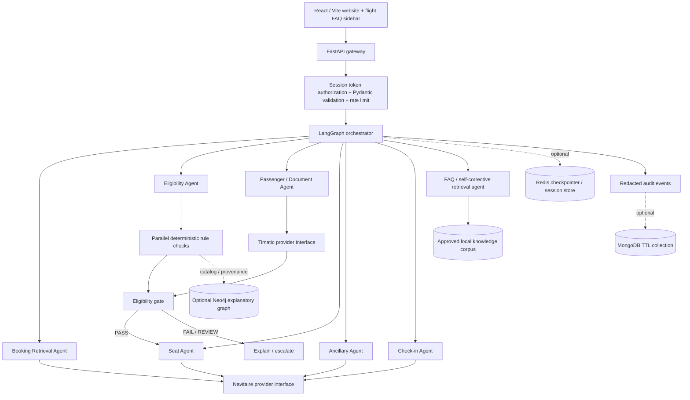

# Architecture and decisions

## Design goal

Demonstrate a secure-by-design, open-source multi-agent *workflow* for an Emirates-inspired synthetic check-in journey without connecting to live airline, Timatic, immigration or payment services.

## High-level topology

## Why LangGraph

The orchestration graph routes an allowlisted `action` to an agent node, returning only opaque references and state metadata to graph state. The raw payload and result live only for the duration of one dispatch call, rather than entering a persistent checkpoint. A later iteration can model the entire multi-step passenger journey as a single long-lived graph with explicit interrupts; for this POC, each UI action is a short graph invocation keyed by the same session thread. The agent/service classes contain deterministic operation logic, not independent unconstrained LLMs. This improves reproducibility and fits the high consequence of eligibility checks.

MemorySaver is the local default when LangGraph is installed. A Redis-backed checkpointer is optional and must fail startup if explicitly configured but unavailable. The session repository separately stores synthetic workflow state and has its own TTL. Redis should not be described as the authoritative booking database.

## Separate roles of the systems

- **Navitaire:** mock adapter boundary for reservation retrieval, seats, ancillaries, booking comments and eventual check-in/provider results. It does not establish that Emirates uses Navitaire.
- **Timatic:** mock adapter boundary for passport/visa/health-document requirement results. No real Timatic request is sent.
- **Pydantic and deterministic services:** enforce input shapes, invariants, transaction eligibility and hard gates.
- **Neo4j:** optional rule relationships and provenance for explainability; not the verdict source of truth.
- **Agentic RAG:** a LangGraph state machine plans/decomposes queries, retrieves from the active approved SQLite FAQ corpus, and can optionally use a private Chroma/SQLite bridge and an allowlisted general SearXNG-compatible official-site search endpoint. It grades evidence, retries with rewritten queries, checks source/authority scope for high-risk topics, evaluates answer support and abstains on gaps. Remote source endpoints must use HTTPS; configured backend failure does not silently switch corpora.
- **MongoDB:** optional short-lived redacted operational events with TTL. This is separate from session state.
- **Kafka / Redis Streams:** deferred; there is no need for event streaming to complete the current browser flow. Add a durable stream only if independent consumers/replay become a requirement.

## Decision safety

Each decision follows a structured contract. `FAIL` and `REVIEW_REQUIRED` are not approvals. The document gate cannot be overridden by chat content, a RAG answer, or a model response. Boarding-pass creation checks all required state before generating any result. The result explicitly says it is a decorative mock and not valid for travel.

## Multi-agent means constrained specialization

The system uses named specialist agents, each with limited operations, and an orchestrator that routes per API action/page. In the current baseline, agents are deterministic Python services rather than six independent LLMs. If a model is added for natural-language intent, it should select from a schema-constrained allowlist and never own the actual eligibility verdict, booking mutation or permission decision.

## Multi-journey handling

The document-validation agent fans out one mock Timatic-style check per passenger × journey and aggregates outcomes fail-closed. Seat assignment is keyed by `passenger_key#journey_key`, and check-in requires a seat for every passenger on every journey before creating one decorative pass record per combination. The `EM5M8Q / CONNECT` fixture exercises this path. This is a demonstration contract: actual Navitaire segment, leg, through-check-in, and boarding-pass semantics must be verified against an authorized provider contract before any live integration.
